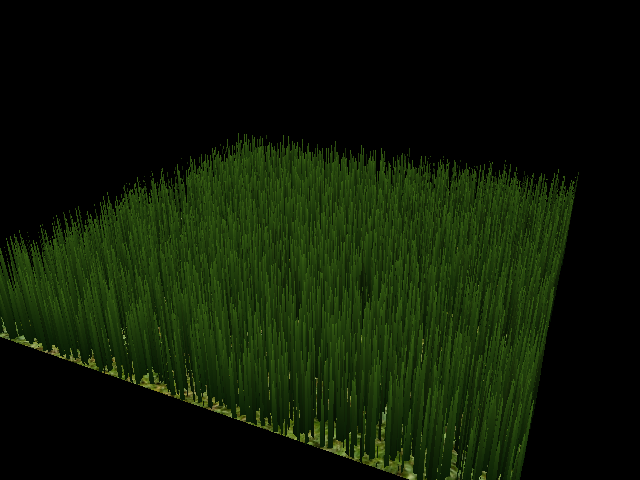

# Vulkan Grass Rendering

**University of Pennsylvania, CIS 565: GPU Programming and Architecture — Project 5**

Zachary Kelly

Tested on Windows with an NVIDIA GeForce RTX 3070, driver 616.56,
Visual Studio 2022, CMake 3.31.6, and Vulkan SDK 1.4.363.0.



This renderer draws 8,192 grass blades on a textured ground plane. A compute
shader copies the blade data into a vertex buffer and writes the arguments for
an indirect draw. Tessellation turns each blade's quadratic Bézier curve into
a tapered strip, with darker roots and lighter tips.

The grass is static at this stage. Wind, gravity, recovery, and culling are
planned next.

## Build and run

The project needs the Visual Studio C++ tools, CMake 3.x, and the Vulkan SDK.
Set `VULKAN_SDK` to the SDK directory if the installer has not already set it.
The GPU must support tessellation shaders.

Run from the repository root in PowerShell:

```powershell
$cmake = 'C:/Program Files/Microsoft Visual Studio/2022/Community/Common7/IDE/CommonExtensions/Microsoft/CMake/CMake/bin/cmake.exe'
& $cmake -S . -B build -G "Visual Studio 17 2022" -A x64
& $cmake --build build --config Debug -j 8
Push-Location build/src
../../bin/Debug/vulkan_grass_rendering.exe
Pop-Location
```

The working directory must be `build/src`, where CMake places the shaders and
ground texture. The Visual Studio debugger uses this directory automatically.
Debug builds enable the Khronos validation layer; Release builds disable it.

For a run that exits after 120 frames:

```powershell
Push-Location build/src
../../bin/Debug/vulkan_grass_rendering.exe --frames 120
Pop-Location
```

| Input | Action |
| --- | --- |
| Left mouse button and drag | Orbit the camera |
| Right mouse button and drag | Move closer or farther away |
| Close the window | Exit |

The commands use CMake bundled with Visual Studio. The starter's GLFW uses an
old policy that CMake 4 no longer supports. `src/CMakeLists.txt` was changed to
find `glslangValidator` through the SDK or PATH, recompile changed shaders, and
set the debugger's working directory.

## Static grass

Each blade uses four packed vectors for its control points, orientation, height,
width, up direction, and stiffness. The CPU creates the initial blades with the
starter's random positions and dimensions. The compute pass currently preserves
all of them, so each invocation writes to its own output slot. One invocation
writes the full indirect draw command. There is no shared counter reset or
compaction yet.

The graphics pipeline reads one blade per patch. Tessellation uses one segment
across the width and eight along the curve. The evaluation shader computes the
quadratic Bézier centerline, adds an offset across the blade's orientation, and
reduces that offset to zero at the tip. It then applies the model and camera
transforms. A simple directional light shades both sides of the blade.

A semaphore makes the indirect draw and vertex input wait for compute. This
version finishes each frame before reusing the shared buffers, so it also keeps
camera and time updates from overlapping GPU reads. That is a simple starting
point, but it does not overlap multiple frames.

## Validation

Debug and Release builds both completed 120-frame runs and exited normally.
The Debug run enabled Khronos validation and synchronization validation and
reported no messages. All seven shaders compiled with `glslangValidator` and
passed `spirv-val`. The capture above shows the static field at 640 × 480.

To enable synchronization validation before running the Debug build:

```powershell
$env:VK_LAYER_ENABLES = 'VK_VALIDATION_FEATURE_ENABLE_SYNCHRONIZATION_VALIDATION_EXT'
```

## Current limits

There are no performance results yet. The current pass draws every blade and
does not simulate forces. The frame wait also limits throughput, so these runs
are correctness checks rather than performance measurements.

The project follows the supplied course starter and the blade representation in
[Responsive Real-Time Grass Rendering for General 3D Scenes](https://www.cg.tuwien.ac.at/research/publications/2017/JAHRMANN-2017-RRTG/JAHRMANN-2017-RRTG-draft.pdf).
GLFW, GLM, and stb_image are included with the starter.
