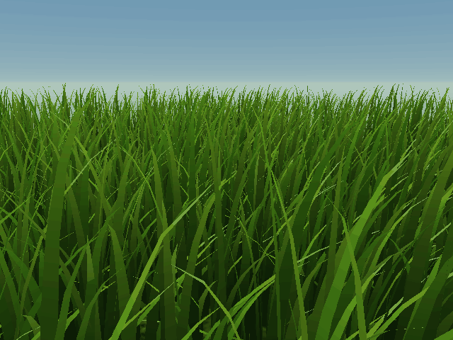
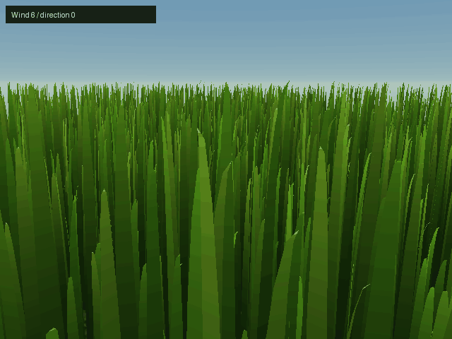
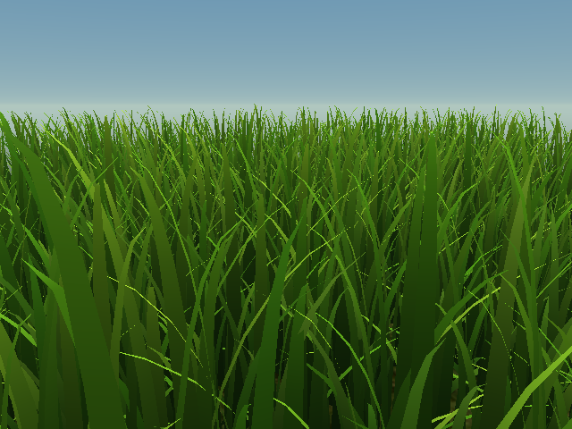
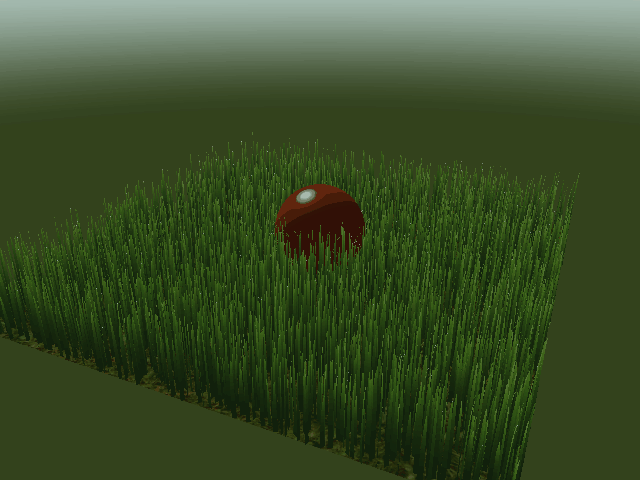

Vulkan Grass Rendering
======================

**University of Pennsylvania, CIS 565: GPU Programming and Architecture, Project 5**

* Zachary Kelly
* Tested on Windows with an NVIDIA GeForce RTX 3070, driver 616.56
* Visual Studio 2022, CMake 3.31.6, Vulkan SDK 1.4.363.0



I implemented a compute shader that simulates grass and removes blades before an
indirect draw. Each blade is a quadratic Bézier curve. Tessellation turns the curve
into a tapered strip, and a directional light shades both sides with darker roots
and lighter tips. The default scene has 8,192 blades.

## Rendering stages

I started by drawing the static Bézier blades, then added forces, then culling.
These captures use the same orbit and initial field with fixed eight-segment
blades so the stages are directly comparable.

| Static blades | Gravity, recovery, and wind | Simulation and all culling |
| --- | --- | --- |
|  |  |  |

## Simulation


Gravity pulls each tip down and slightly forward. Recovery pulls it toward its
original upright position, with the blade's stiffness controlling the strength.
Wind varies with position and time so the whole field does not move together. Its
force also depends on the blade's direction and how upright it is.

After each update, I keep the tip above the ground plane and move the middle control
point along the blade's up direction. I then rescale the curve using the paper's
approximate arc length. This keeps the blade from stretching as it bends, although
it does not preserve the exact arc length. Simulation steps are at most 1/120 second,
and a frame's elapsed time is capped at 1/30 second to avoid large jumps after a stall.

All blades are simulated before culling. Moving the camera or hiding a blade therefore
does not reset or freeze its motion.

## Interactive wind



The up and down arrows change wind strength by 0.5, clamped between zero and 100.
The left and right arrows rotate the wind by five degrees. Holding a key repeats
the change, and the window title shows the current strength and direction offset.
The spatial wind waves still vary over time around that direction. Space pauses
simulation, so changes made while paused take effect when it resumes.

`--wind 12 --wind-direction 90` sets the initial values. `--wind-demo` applies two
repeatable changes through the same arrow-key callback, which I use for the capture
above. The labels in the GIF were added during capture conversion; live values are
shown in the window title.

## Lighting and background



I added a procedural sky with a blue upper hemisphere, a pale horizon, and a warm
sun glow. A muted earth-colored lower hemisphere replaces the black background
below the horizon. It is a fullscreen triangle whose rays follow the camera,
not additional terrain geometry. Sky pixels keep the far depth, so the ground and grass render in front of them.
The sphere writes its surface depth in the same pass.

The grass combines warm diffuse sunlight, cool ambient light, a small highlight,
and a backlighting term that approximates light passing through a thin blade.
A stable per-blade color variation breaks up the field, darker roots suggest the
dense canopy, and distance haze softens the far grass. The sky and grass use the
same sun direction. The ground texture is muted to fit the new lighting.
These are shading approximations; there are no cast shadows or physical atmosphere.

## Collision interaction and occlusion



WASD moves a sphere across the field. The compute shader samples four points along
each blade's curve and applies a repulsion force where they enter the sphere.
The existing curve correction keeps roots anchored and maintains the approximate
length. Grass recovers after the sphere moves away. This is soft contact, not a
rigid-body solver: some penetration can remain, especially near anchored roots.

The sphere is rendered analytically by intersecting camera rays with its surface
and writing its depth. Grass in front passes the depth test; grass behind it does
not. Its visible surface and the compute shader use the same center and radius.

Press 4 to toggle occlusion culling. A bounding sphere encloses each blade's control
hull and width. The compute shader rejects it only when that entire bound is behind
the collision sphere and fits inside its angular silhouette, with a small safety
margin. This avoids a depth-map readback and keeps partial silhouettes. The test is
specific to this sphere; it does not cull against arbitrary meshes or other grass.

In the close-view check, this removed 5,002 of 65,536 blades with pixel-identical
images. Collision changed 2,568 blades, while enabling occlusion left simulation
buffers byte-identical. Across 33 image pairs, the close view was identical; the
other views differed by at most seven isolated pixels out of 307,200. Repeating
those views with occlusion disabled also changed up to seven pixels, consistent
with equal-depth fragments resolving differently after atomic compaction. The
check records both differences and limits either to 16 pixels. See [interaction checks](performance/interaction-validation.json).

Use `--no-collider` to remove the object, `--no-collision` to keep it visible without
repulsion, or `--no-occlusion` to draw hidden blades as well. `--collision-demo`
moves the sphere along a repeatable path for captures.

## Culling

I implemented three culling tests that can be enabled separately:

* **Orientation:** Remove blades viewed nearly along their width direction. The
  threshold is an absolute dot product greater than 0.9.
* **Frustum:** Test the curve's control-point hull and midpoint against the clip
  planes, including blade width and a 5% margin on the sides of the screen. A blade
  is removed only when all points are outside the same plane.
* **Distance:** Thin the field in eight distance buckets, measured along the ground
  plane, and remove blades beyond 40 units. A hash of the blade index keeps the
  selected subset stable between frames.

The compute pass resets the indirect vertex count, then each surviving blade uses
an atomic increment to reserve an output slot. Buffer barriers order the counter
reset and shader accesses. A semaphore makes the draw wait for compute before reading
its vertex buffer and indirect arguments.

These images use the same 65,536-blade scene, camera, and simulation time:

| Culling off | All culling enabled |
| --- | --- |
|  |  |

Orientation and distance culling change the visible geometry and density. They save
work, but the resulting image is not identical to drawing every blade.

## Distance-based tessellation

I added distance-based level of detail in the tessellation control shader. Blades
within five units of the camera keep eight segments along their curve. Between
five and 40 units, a smoothstep function lowers the requested level toward two
segments. Blades at 40 units or farther use two segments. The width stays at one
segment, and both long edges use the same level.

This is enabled by default. `--no-lod` restores the fixed eight-segment version.
The distance uses the blade root transformed into world space and the camera's
world position. It changes only tessellation; simulation and culling stay the same.
The evaluation shader uses equal spacing, which rounds levels up to whole segments,
so the mesh still changes in discrete steps as the camera moves.

| Fixed eight segments | Distance-based tessellation |
| --- | --- |
|  |  |

These distant-view captures disable culling so all 65,536 blades remain visible to
the pipeline. Otherwise, distance culling would hide the field before we could
compare the low-detail geometry.

## Performance

These measurements use the current renderer, including collision, the sphere, sky,
and updated lighting. Occlusion is disabled for the original three culling tests
and the LOD comparison, then measured separately below.

I measured Release builds at 640 by 480 using offscreen rendering. Each run used
60 warmup frames followed by 180 measured frames, with a fixed simulation step of
1/60 second. I ran each configuration twice in a shuffled order with the same initial
blade positions and wind strength. Validation and implicit Vulkan layers were disabled.

The culling measurements below use fixed eight-segment tessellation (`--no-lod`).
The times below are medians over 360 samples. GPU timestamps measure the compute
pass, including the counter reset, and the graphics pass, including the ground.
Total GPU time is the median of each frame's compute and graphics time added together.
It excludes presentation, image capture, and CPU readback.

### Blade count

These runs use the close camera view.

| Blades | No culling, GPU ms | All culling, GPU ms | Blades drawn with all culling |
| ---: | ---: | ---: | ---: |
| 8,192 | 0.054 | 0.045 | 2,789 |
| 65,536 | 0.303 | 0.207 | 22,327 |
| 262,144 | 1.426 | 0.880 | 88,997 |

At 262,144 blades, all three tests reduced median GPU time by about 38%. At 8,192
blades, the absolute difference was only 0.009 ms, so small timing variations matter
more. Simulation still runs for every blade; culling mainly reduces the draw work.

### Individual tests

These runs use 65,536 blades. The overview camera sees almost the entire field.

| Culling | Close: blades drawn | Close: compute ms | Close: graphics ms | Close: total ms | Overview: total ms |
| --- | ---: | ---: | ---: | ---: | ---: |
| None | 65,536 | 0.035 | 0.268 | 0.303 | 0.354 |
| Orientation | 54,129 | 0.033 | 0.211 | 0.244 | 0.334 |
| Frustum | 33,783 | 0.031 | 0.260 | 0.291 | 0.355 |
| Distance | 56,287 | 0.034 | 0.222 | 0.256 | 0.224 |
| All | 22,327 | 0.030 | 0.177 | 0.207 | 0.218 |

Frustum culling removed almost half the blades in the close view, but saved much less
time than orientation or distance culling. My interpretation is that many rejected
blades were already offscreen, where hardware clipping avoided fragment work. In the
overview, frustum culling removed only ten blades and made essentially no difference.

The raw samples are in [performance/measurements](performance/measurements). The
[summary](performance/summary.json) includes means, medians, and 95th percentiles;
[runs.json](performance/runs.json) records each run's settings and final visible count.
These are GPU pass measurements, not interactive FPS. The renderer waits for each
frame to finish before reusing its shared buffers, so it does not overlap frames.

### Tessellation LOD

I compared fixed and distance-based tessellation with 65,536 blades and culling
disabled. These are separate paired runs using the same Release setup, 60 warmup
frames, and two runs of 180 measured frames per setting.

| Camera | Fixed: graphics ms | LOD: graphics ms | Fixed: total GPU ms | LOD: total GPU ms |
| --- | ---: | ---: | ---: | ---: |
| Close | 0.284 | 0.265 | 0.319 | 0.300 |
| Overview | 0.317 | 0.269 | 0.352 | 0.303 |
| Distant | 0.335 | 0.092 | 0.369 | 0.127 |

The distant view reduced median graphics time by about 72%. Every blade still went
through simulation and rendering, but each distant curve used two segments instead
of eight. The close view saved much less because nearby blades kept their detail.
These results isolate tessellation; with default distance culling, the distant field
would already be removed. Fewer segments also change silhouettes and pixel coverage,
so the images are similar at this scale, not identical.

The [LOD samples and summary](performance/lod) include both modes and all three views.

### Sphere occlusion

These paired runs use 65,536 blades, distance-based tessellation, collision, and no
other culling. Both versions draw the sphere and run the same simulation.

| Camera | Blades drawn with occlusion | Occlusion off: GPU ms | Occlusion on: GPU ms |
| --- | ---: | ---: | ---: |
| Close | 60,435 | 0.331 | 0.278 |
| Overview | 65,271 | 0.333 | 0.317 |
| Distant | 64,532 | 0.128 | 0.127 |

Occlusion reduced median GPU time by about 16% in the close view, where the sphere
covers a substantial part of the field. The overview rejects only 265 blades and
the distant view uses very little geometry already. Small differences there are
sensitive to run-to-run timing variation; two runs are not enough to establish a
consistent gain. The [raw measurements](performance/occlusion) include compute and
graphics timings for both runs of every configuration.

## Build and run

I modified `src/CMakeLists.txt` beyond the source list: it locates
`glslangValidator` through the Vulkan SDK or PATH, compiles shaders with dependency
tracking into `build/src/shaders`, makes the executable depend on those outputs,
and sets the Visual Studio debugger's working directory to `build/src`.
The root `CMakeLists.txt` is unchanged.

The project needs the Visual Studio C++ tools, CMake 3.x, and the Vulkan SDK.
Set `VULKAN_SDK` to the SDK directory if the installer has not already set it.
The GPU must support tessellation shaders.

Run from the repository root in PowerShell:

```powershell
$cmake = 'C:/Program Files/Microsoft Visual Studio/2022/Community/Common7/IDE/CommonExtensions/Microsoft/CMake/CMake/bin/cmake.exe'
& $cmake -S . -B build -G "Visual Studio 17 2022" -A x64
& $cmake --build build --config Debug -j 8
& $cmake --build build --config Release -j 8
Push-Location build/src
../../bin/Release/vulkan_grass_rendering.exe
Pop-Location
```

The working directory must be `build/src`, where CMake places the compiled shaders
and ground texture. The Visual Studio debugger uses this directory automatically.
Debug builds enable the Khronos validation layer; Release builds disable it. The
commands use CMake bundled with Visual Studio because the starter's GLFW uses an old
policy that CMake 4 no longer supports.

| Input | Action |
| --- | --- |
| Left mouse button and drag | Orbit the camera |
| Right mouse button and drag | Move closer or farther away |
| 1 | Toggle orientation culling |
| 2 | Toggle frustum culling |
| 3 | Toggle distance culling |
| 4 | Toggle sphere occlusion culling |
| W / A / S / D | Move the collision sphere across the ground |
| Up / Down arrows | Increase / decrease wind strength |
| Left / Right arrows | Rotate wind direction |
| Space | Pause or resume simulation |
| Escape | Exit |

For example, run these commands from `build/src`:

```powershell
../../bin/Release/vulkan_grass_rendering.exe --blades 65536 --view close --culling none
../../bin/Release/vulkan_grass_rendering.exe --wind 12 --frames 600
../../bin/Release/vulkan_grass_rendering.exe --static --culling all
../../bin/Release/vulkan_grass_rendering.exe --offscreen --frames 240 --warmup 60 --benchmark timings.csv
```

`--culling` accepts `none`, `orientation`, `frustum`, `distance`, or `all`.
`--view` accepts `overview`, `close`, `distant`, or `away`. `--fixed-dt` sets a
repeatable simulation step, and `--verify` checks the final GPU buffers. Use `--help`
for the remaining capture and timing options.

## Validation

Debug and Release builds completed successfully, and all nine compiled shaders
passed `spirv-val`. The 13 GPU validation cases passed with Khronos synchronization
validation enabled and no reported validation messages. They cover partial workgroups,
a single blade, an empty visible set, each culling mode, static grass, strong wind,
a longer simulation, and timestamp queries.

Readback checks the indirect command, finite blade values, tip height, approximate
curve length, and output membership without duplicates. The simulation buffers matched
byte for byte across culling modes and camera views. The maximum relative error in
the approximate length was below one millionth. The results are saved in
[performance/validation.json](performance/validation.json).

Eleven capture cases passed validation, including the incremental stages, both LOD
modes, repeated offscreen image
copies and a normal presented run. To reproduce the checks and measurements after
building both configurations, run from the repository root:

```powershell
./tests/run-validation.ps1
./tests/benchmark.ps1
./tests/benchmark-lod.ps1
./tests/benchmark-occlusion.ps1
python tests/summarize-benchmarks.py
python tests/summarize-lod.py
python tests/summarize-occlusion.py
./tests/capture.ps1
python tests/make-captures.py
```

The appearance checks also exercise wind changes through the key callback, calm
and reversed wind, the sky view, and normal presentation:

```powershell
./tests/capture-appearance.ps1
python tests/make-appearance.py
```

The capture conversion scripts need Pillow. The PowerShell scripts restore their
Vulkan environment settings when they finish. They batch runs in one process to avoid
repeating the slow GLFW initialization on the test machine.

The interaction check compares rendered images with occlusion on and off, checks
that collision changes the simulated curves, and verifies that occlusion leaves
the simulation unchanged:

```powershell
./tests/capture-interaction.ps1
python tests/check-interaction.py
```

`./tests/check-controls.ps1` runs `--check-controls`, which exercises repeated key callbacks, orbit and zoom callbacks,
pause/resume, and actual window resizes from 640 by 480 to 800 by 600 and back.
That presented Debug run passed synchronization validation. Desktop automation
could not initialize, so this is an automated callback/window-event check, not a
manual input-device check.

## Current limits

The blades interact with the sphere but do not collide with each other. Distance buckets can cause
visible density changes as the camera moves, and orientation culling can remove thin
silhouettes. Low-detail blades approximate the curve with fewer straight sections, and discrete
tessellation changes can be visible while moving. Occlusion only handles the sphere,
and the per-frame wait limits throughput.

The project follows the supplied course starter and the blade representation in
[Responsive Real-Time Grass Rendering for General 3D Scenes](https://www.cg.tuwien.ac.at/research/publications/2017/JAHRMANN-2017-RRTG/JAHRMANN-2017-RRTG-draft.pdf).
GLFW, GLM, and stb_image are included with the starter.
